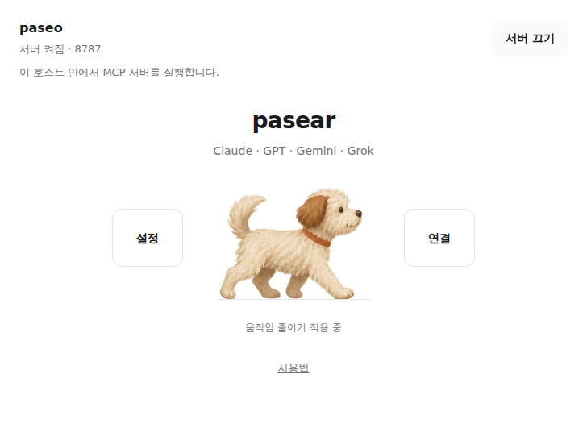

# pasear

Control your Paseo agents from web chat. Start work, inspect several agents, switch between tasks, send follow-ups, read conversations and activity, summarize results, and stop a run through a remote MCP connection.

[한국어 안내](README.ko.md)



```text
Web chat → your HTTPS proxy → pasear MCP server → Paseo → coding agents
```

## Install

Requires Paseo daemon and client **0.11.2 or later**, npm, and the local `paseo` CLI for stopping runs and importing native sessions.

```bash
paseo plugin add git:tkfka1/pasear --ref v0.10.2
```

Paseo installs the locked runtime dependencies with `npm ci --omit=dev --ignore-scripts`. The installed plugin ID remains `paseo-mcp-plugin`; the display name is **pasear**. The interface is currently in Korean.

## Connect a chat

1. Open **pasear** in Paseo. Select the host you want to control.
2. Configure a public HTTPS proxy or load balancer for that host's listener. The default listener is `0.0.0.0:8787`, allowing network access from your proxy. Choose `127.0.0.1` in advanced settings for a proxy on the same host only. Existing saved settings keep their selected address.
3. Enter the public MCP URL, such as `https://mcp.example.com`, and select **Save and start**. Further settings and chat connections stay on the same screen. The listener starts stopped after a plugin reload.
4. Add that URL as an OAuth MCP connector in your chat. For Claude, choose **Automatically register** (DCR).
5. Enter the connection key in the OAuth browser window. In Paseo, compare the confirmation code and callback URL, select allowed workspaces, and approve the connection.

The domain root is the MCP endpoint; existing `/mcp` addresses and approved connections also remain supported. Route the entire public hostname to the listener, preserving paths. OAuth also needs `/authorize`, `/register`, `/token`, `/revoke`, `/oauth/flow/*`, and `/.well-known/*`, not just `/mcp`. The connection key belongs in the OAuth browser form, never in chat or a custom API-key header.

Claude, ChatGPT, Gemini, and Grok connector availability depends on the account, plan, region, and service. Full real-account testing across all four is incomplete. See the [Korean guide](README.ko.md#웹-채팅-설정) for service-specific references.

## Use it conversationally

Select the connector in your chat, then ask naturally:

- “Show the current tasks and anything that needs my attention.”
- “Check the login task, then tell that agent to run regression tests.”
- “How is the deployment task going?”
- “Summarize the result in three lines.”
- “Stop that task.”
- “Bring back the archived login task's original session.”
- “Summarize the login task's history and hand it to a new Codex agent.”

The chat model chooses and combines tools; no invocation keyword is required. It keeps task IDs within the current chat. Exact unique task/workspace names also work, and ambiguous names require selection. The web chat brand does not determine which coding provider runs the task.

| Tool | Purpose |
| --- | --- |
| `list_workspaces` | Discover allowed workspaces and their projects. |
| `list_agents` | List tasks and their state; include archived tasks when needed. |
| `list_providers` | Discover available coding providers for a workspace. |
| `list_models` | Choose a provider model. |
| `create_agent` | Create a task and return an acceptance receipt. |
| `send_agent_prompt` | Send a follow-up; steer by default, interrupt only when requested. |
| `get_agent` | Inspect summary, status, conversation messages, or paged work activity; optionally wait up to 20 seconds. |
| `cancel_agent` | Request interruption of the current run while retaining history and edits. |
| `import_agent` | Recover an original provider session (`native`) or start a separate session from history (`handoff`). |

Acceptance is not completion, and an idle state is not proof of success. Follow history cursors before claiming to have read a whole conversation. The chat model generates retry keys and reuses them only for the same intended operation.

Native import requires host-wide access with the current CLI, retained provider session data, and provider recovery support. It does not send a follow-up prompt or change the provider. Handoff needs read access to the source and creation access to the destination; it carries a chat-written summary plus bounded recent history. It does not restore old files, branches, worktrees, or provider runtime state.

## Access and multiple hosts

Each connection has one task-control permission, limited to the projects, workspaces, and agents allowed by the owner. Whole projects/workspaces include future children; an agent-only selection cannot create new agents. Access edits and revocation apply without reconnecting. These limits govern MCP operations, not the provider's filesystem sandbox or tool permissions. Answer provider permission requests in Paseo.

Install pasear independently on each host. Each needs its own public URL and chat connector. Changing the host in the Paseo screen does not retarget a connected chat, and the load balancer must not distribute requests across unrelated hosts.

Prompts and selected history go to the chat service and selected coding provider. OAuth state stays on the daemon host. Tool activity omits raw tool arguments/output and reasoning; conversation text may contain sensitive task data. This plugin is trusted local code and uses OAuth DCR, S256 PKCE, a connection key, and explicit owner approval.

## Develop and verify

```bash
npm ci --ignore-scripts
npm run typecheck
npm test
```

The suite covers HTTP MCP, OAuth, scoped access, lifecycle, import/handoff, concurrent retries, and access changes during requests. Mutation tests use fake Paseo APIs and CLI execution; actual user-session restoration and new-agent execution are not part of those checks. Public HTTPS authentication, owner approval, SDK reads, and revocation have been checked separately.

## License

[MIT](LICENSE)
